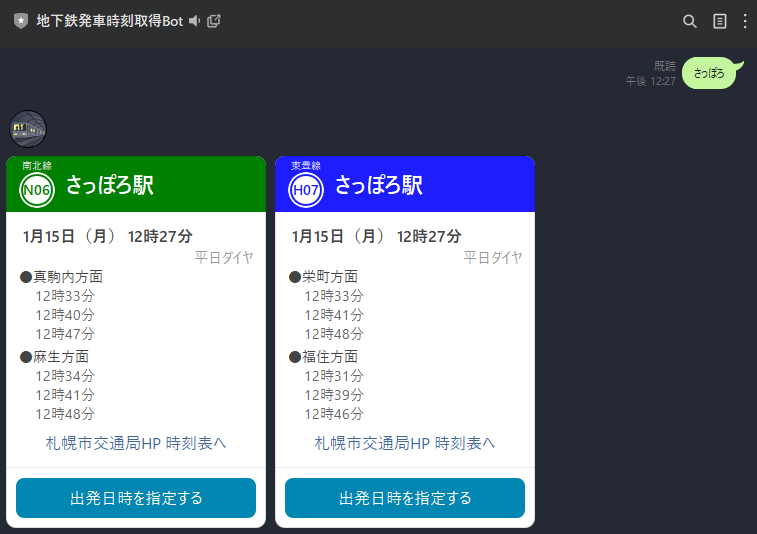
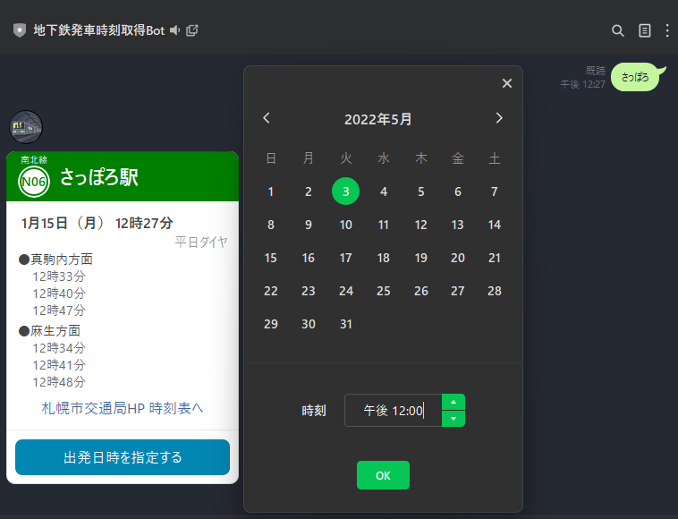
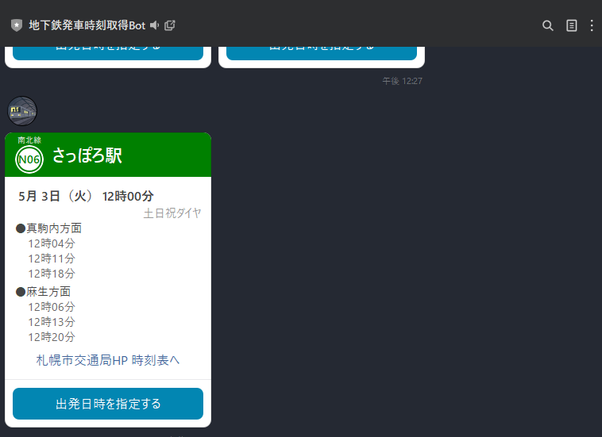

# subway-line-bot

## 概要

札幌市営地下鉄の駅名を入力すると、その駅から何時に電車が発車するかを返信してくれる LINE Bot です。

アカウント: [@521yoari](https://line.me/R/ti/p/@521yoari?from=page&accountId=521yoari)

「もう少し早歩きしていれば、1本前の電車に乗れたのに...」 
「コンビニ寄ってからでも次の電車に間に合ったな...」

この Bot を使えば、このようなちょっぴり損した？気分を防ぐことができます。

## 使い方

### 駅名から時刻表を検索する

駅名を入力すると、その駅からの電車の発車時刻を直近 3 つ分返信してくれます。

駅名入力は下記に対応しています。また、「駅」は付けなくても大丈夫です。

- 正式名称（e.g. `琴似駅` → `東西線 琴似駅`）
- ひらがな（e.g. `まこまない` → `南北線 真駒内駅`）
- 全角カタカナ／半角ｶﾀｶﾅ（e.g. `サカエマチ` / `ｻｶｴﾏﾁ` → `東豊線 栄町駅`）
- 一部略称（e.g. `さつえき` → `南北線 さっぽろ駅` & `東豊線 さっぽろ駅`, `にーよん` → `南北線 北24条駅`, `なんぴら` → `南北線 南平岸駅`）
  - 使用できる略称は [/src/constants/stations.ts](https://github.com/antimacho612/subway-line-bot/blob/main/src/constants/stations.ts) の `commonNames` を参照してください

大通駅やさっぽろ駅など、複数の路線が存在する駅については、その路線分時刻表が表示されます。

### 時刻を指定して時刻表を検索する

Bot から返信された時刻表メッセージから、日時を指定して時刻表を再検索することができます。

## 時刻表データについて

時刻表データは、[札幌市交通局の公式サイト](https://www.city.sapporo.jp/st/subway/route_time/)に掲載されている各駅の時刻表ページを元に作成しています。

- 2024 年 1 月時点のデータを元にしています
- ダイヤ改正や臨時ダイヤなどにより、実際の発車時刻と**必ずしも一致しない可能性があります**
- 正確な時刻は、各時刻表メッセージの「札幌市交通局HP 時刻表へ」から公式サイトでご確認ください

## デプロイ

[Vercel](https://vercel.com/) にデプロイしています。

1. Vercel のプロジェクト設定で次を設定する
   - Node.js Version: `24.x`（`package.json` の `engines` と合わせる）
   - 環境変数: `LINE_CHANNEL_ACCESS_TOKEN`, `LINE_CHANNEL_SECRET`
2. デプロイ後、[LINE Developers コンソール](https://developers.line.biz/console/)の「Messaging API 設定」で Webhook URL に `https://<デプロイ先のドメイン>/webhook` を設定する
3. 「Webhook の利用」がオンになっていることを確認し、Webhook URL の「検証」ボタンを押して「成功」と表示されることを確認する
